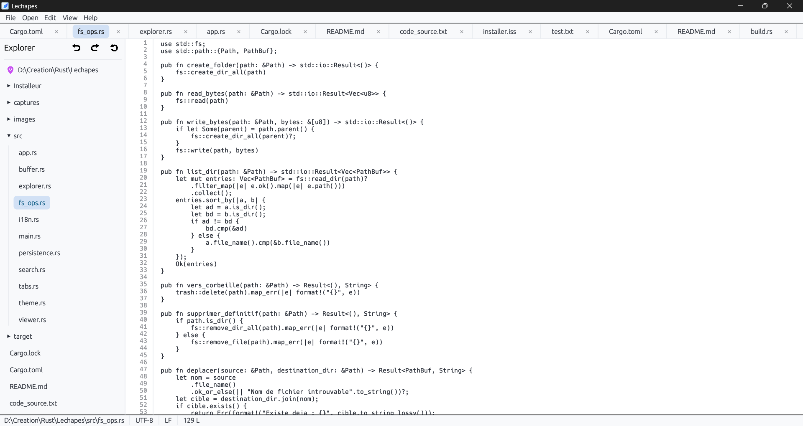
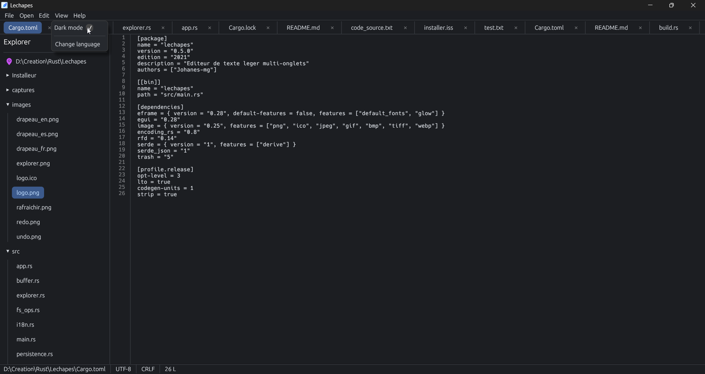
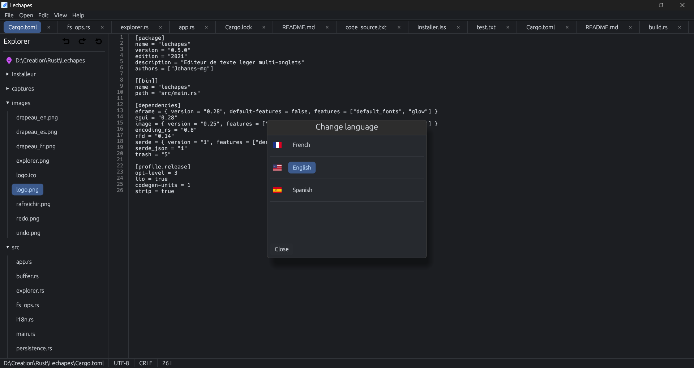
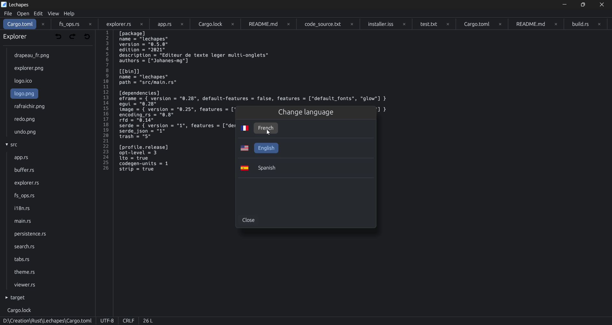
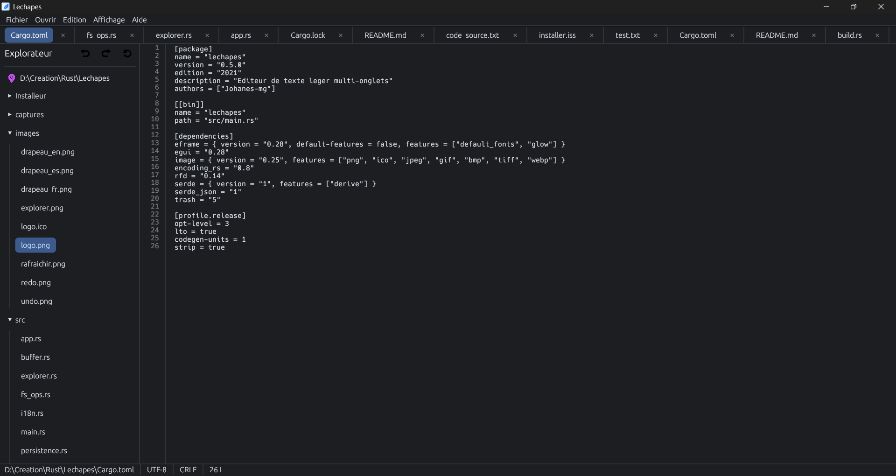
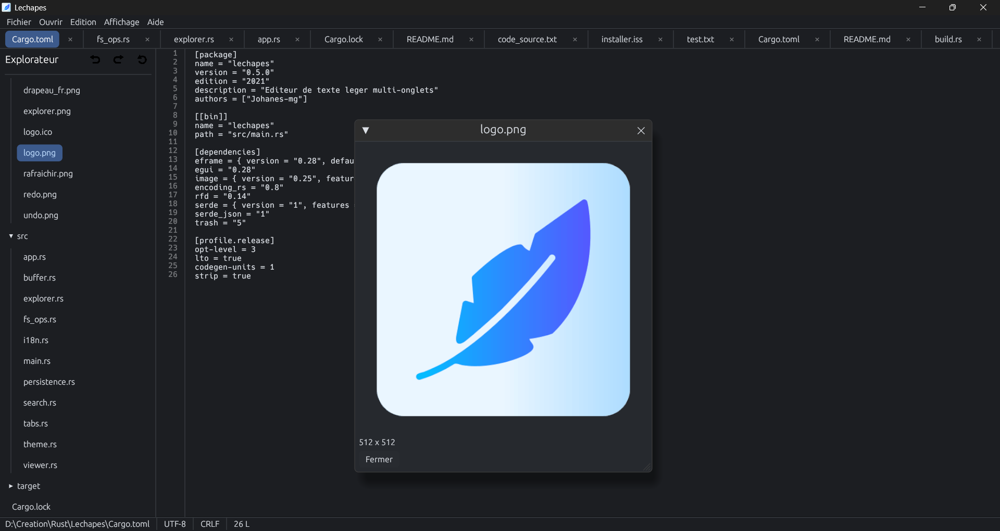

# Lechapes

<div align="center">

<div align="center">
  
</div>


**Lightweight, modern, multi-tab text editor developed in Rust with egui.**

[](https://github.com/Johanes-mg/Lechapes/releases)
[](LICENSE)
[](https://www.rust-lang.org)

</div>

---

## About Lechapes

**Lechapes** is a minimalist, fast, and feature-rich text editor designed to provide a smooth and pleasant editing experience. Developed entirely in **Rust** using the **egui/eframe** graphical interface library, it combines high-level performance with a low memory footprint.

---

## Key Features

- **Multi-tab** : Open and manage multiple files simultaneously with keyboard shortcut support and middle-click tab closing.
- **Integrated file explorer** : Easily browse your folders, open files, and refresh the tree view with a single click.
- **Encoding and line ending management** : Automatic detection of encodings (UTF-8, UTF-16, Windows-1252, etc.) and line endings (LF / CRLF).
- **Search and Replace** : Advanced search tools with case sensitivity support, single or global replacement (`Ctrl + F`, `Ctrl + H`).
- **History (Undo / Redo)** : Complete modification management system (`Ctrl + Z`, `Ctrl + Y`).
- **Session persistence** : Automatic restoration of your open tabs when relaunching the application.
- **Multilingual interface** : Available in **French**, **English**, and **Spanish**.
- **Dark / Light mode** : Easily switch between an elegant dark theme and a bright light theme.

---

## Lechapes Overview

<div align="center">

### Main menu



### Dark Mode



### Language selection



### Language selection fr



### Main menu fr



### Integrated image viewer




</div>

---

## Technologies Used

- **[Rust](https://www.rust-lang.org/)** : Systems programming language guaranteeing safety and speed.
- **[egui / eframe](https://github.com/emilk/egui)** : Immediate and ultra-fast GUI framework for Rust.
- **[rfd](https://github.com/PolyMeilex/rfd)** : Cross-platform native file dialogs.
- **[serde](https://serde.rs/)** : Serialization and deserialization for session management.

---

## Project Structure

Here is the file tree and organization of the solution:

```
Lechapes/
│
├── images/                 # Graphic resources (logos, flags, icons, buttons)
│   ├── drapeau_en.png
│   ├── drapeau_es.png
│   ├── drapeau_fr.png
│   ├── logo.ico
│   ├── logo.png
│   ├── rafraichir.png
│   ├── redo.png
│   └── undo.png
│
├── Installeur/             # Configuration files and installation scripts (Inno Setup)
├── src/                    # Main Rust source code
│   ├── app.rs              # Global application UI logic
│   ├── buffer.rs           # Text buffer management
│   ├── explorer.rs         # Sidebar file explorer
│   ├── fs_ops.rs           # File system operations (read/write)
│   ├── i18n.rs             # Internationalization (FR, EN, ES)
│   ├── main.rs             # Application entry point
│   ├── persistence.rs      # Session save and restore
│   ├── search.rs           # Search and replace algorithms
│   ├── tabs.rs             # Tab management
│   └── theme.rs            # Themes (light / dark)
│
├── .gitignore              # Files and folders ignored by Git
├── Cargo.lock              # Exact versions of Cargo dependencies
├── Cargo.toml              # Rust project configuration and metadata
├── installer.iss           # Windows installer creation script
├── README.md               # Project documentation
└── rust-toolchain.toml     # Rust toolchain configuration


```
## Installation and Compilation
### Prerequisites
Make sure you have **Rust** installed (stable version recommended). You can get it at rustup.rs.
### Compiling from source
 1. Clone the repository:
   ```bash
   git clone [https://github.com/Johanes-mg/Lechapes.git](https://github.com/Johanes-mg/Lechapes.git)
   cd Lechapes
   
   ```
 2. Compile the project in **release** mode (optimized for performance):
   ```bash
   cargo build --release
   
   ```
 3. The generated executable will be located in:
   ```bash
   target/release/lechapes.exe
   
   ```
## Useful Keyboard Shortcuts
| Shortcut | Action |
|---|---|
| Ctrl + N | New file |
| Ctrl + O | Open a file |
| Ctrl + S | Save |
| Ctrl + Shift + S | Save as |
| Ctrl + W | Close active tab |
| Ctrl + F | Search |
| Ctrl + H | Replace |
| Ctrl + Z | Undo |
| Ctrl + Y / Ctrl + Shift + Z | Redo |
| Ctrl + Tab | Switch to next tab |
## 👤 Author
 * **Johanes-mg** 
## 📄 License
This project is under an open license. See the LICENSE file for more details.
```